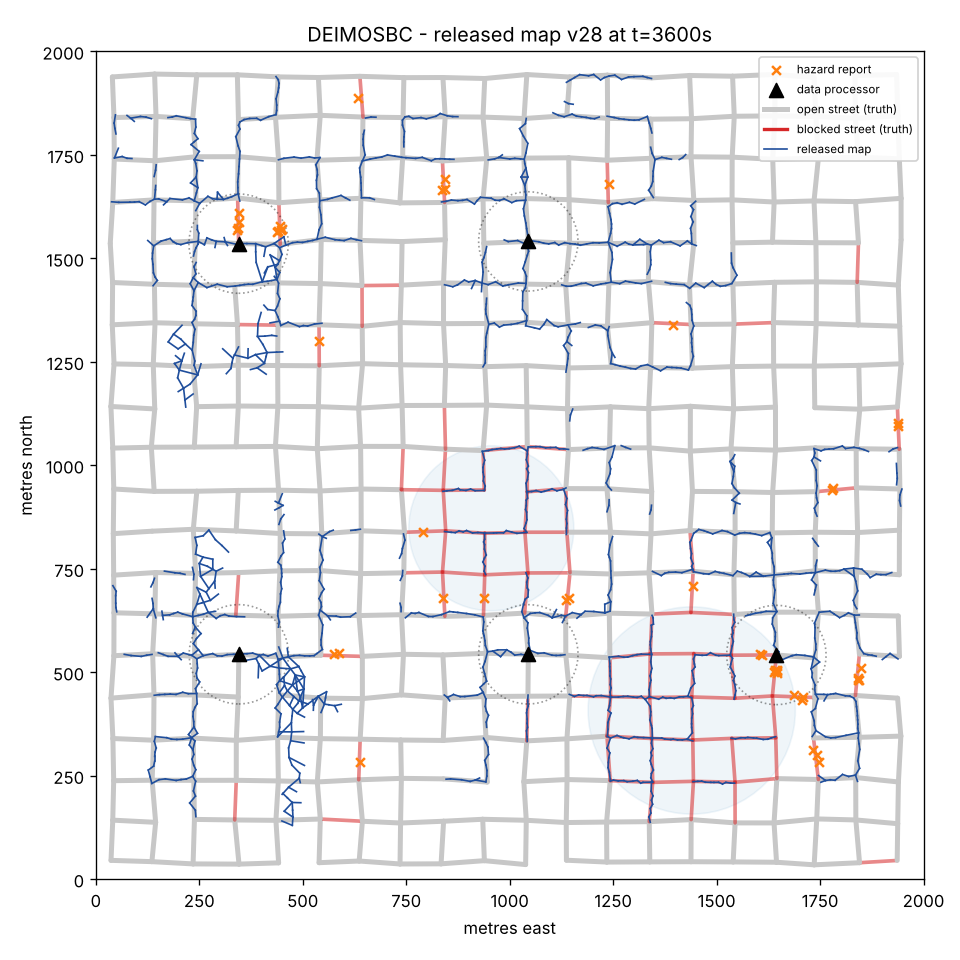

# DEIMOSBC: reference implementation

A complete, runnable implementation of

> **DEIMOSBC: A Blockchain-based System for Crowdsensing after Natural Disasters**
> Raunak Sarbajna, Christoph F. Eick, Aron Laszka. *3rd Conference on Blockchain
> Research & Applications for Innovative Networks and Services (BRAINS 2021).*
> [IEEE Xplore 9569794](https://ieeexplore.ieee.org/document/9569794)

After a disaster, volunteers' phones collect GPS trajectories. The traces
travel over short-range radio to *Data Processors*, which verify them and run
smart contracts that chain them into a pedestrian map of what is still
passable. The resulting map lives on a permissioned blockchain, and anyone
can request it and verify it. No central authority is needed at any point.

THis is an attempt converting the architecture from the 2021 paper into
working software:

* a permissioned **blockchain** with Ed25519 identities, majority-attested
  blocks, deterministic replicated state, and a chain audit tool;
* the paper's **smart contracts**: registration, task assignment, trace
  upload with deposits and rewards, map release, and the *Retirement* freeze;
* the **Trace Management System**: displacement-based sampling and
  trajectory segmentation;
* the **Data Summarization System**: local and global map graphs, overlap
  chaining, and conflict detection;
* **Data Collector**, **Data Processor** and **Requester** nodes talking over
  a simulated ad-hoc radio network with delay-tolerant relaying;
* the paper's **Gulf Coast hurricane scenario** as a reproducible simulation,
  with honest, malicious and faulty volunteers, Byzantine and crashing
  processors, ground-truth metrics, GeoJSON export and parameter sweeps.



*One hour after landfall, 40 volunteers and 5 processors, default settings.
Grey: open streets. Red: flooded or blocked streets. Blue: the released map.
Orange ×: hazard reports. The blue lines on red streets are traces
fabricated by the four malicious volunteers in this run. Under the paper's
conflict rule, a street is only protected from fabrication if an honest
volunteer has reported it as blocked. See [research notes](docs/RESEARCH_NOTES.md).*

## Quick start

```bash
git clone https://github.com/RaunakDune/deimosbc-implementation
cd deimosbc-implementation
pip install -e ".[plot,dev]"        # Python >= 3.10; only hard dependency: cryptography

deimosbc simulate --out runs/demo              # ~30 s, writes report + map + chain
deimosbc verify runs/demo/chain.jsonl          # re-verify the whole chain from genesis
pytest                                         # 53 tests, ~10 s
```

`simulate` writes:

| File | Content |
|---|---|
| `report.json` | metrics, timeline of released map versions, chain, consensus, per-role and network statistics |
| `map.geojson` | the latest released map (edges with support counts, vertices with sensor averages, hazards) |
| `ground_truth.geojson` | streets with a `blocked` flag |
| `map_edges.csv` | released edges in the ProteusData `x0,y0,x1,y1` format |
| `chain.jsonl` | every block, including signatures and attestations |
| `map.png` | the plot above (needs matplotlib) |

Change any setting from the command line or a config file:

```bash
deimosbc simulate --set n_collectors=80 --set frac_fabricate=0.2 --protocol merge_radius_m=12
deimosbc simulate --config examples/byzantine_processors.json
deimosbc simulate --config examples/extensions.json       # opt-in improvements, see below
deimosbc params                                           # all protocol parameters and defaults
deimosbc sweep --grid jitter_m=4,8,12 --grid frac_fabricate=0,0.1 --seeds 3 --out sweep.csv
```

## How the paper maps to the code

| Paper | Code |
|---|---|
| Data Collector (IV-A.1): broadcast, wait for confirmation, queue, alerts, re-authentication | [`nodes/collector.py`](deimosbc/nodes/collector.py) |
| Data Processor (IV-A.2): package verification, author identification, trace processing, result provisioning | [`nodes/processor.py`](deimosbc/nodes/processor.py), [`packets.py`](deimosbc/packets.py) |
| Requester: ask message, global map returned | [`nodes/requester.py`](deimosbc/nodes/requester.py) |
| Data Summarization System (IV-B.1) | [`mapping/merger.py`](deimosbc/mapping/merger.py), [`mapping/graph.py`](deimosbc/mapping/graph.py) |
| Trace Management System (IV-B.2) | [`tms.py`](deimosbc/tms.py) |
| Register / Task Assignment / Upload / Smart Contract Creation (IV-C) | [`contracts/`](deimosbc/contracts) |
| Broadcast and Retirement: freeze, final block, majority vote (IV-C) | [`contracts/governance.py`](deimosbc/contracts/governance.py), [`replica.py`](deimosbc/replica.py) |
| Blockchain ledger | [`ledger/`](deimosbc/ledger), [`replica.py`](deimosbc/replica.py) |
| Assumptions (III-A): no cellular network, Bluetooth / WiFi only | [`network.py`](deimosbc/network.py) |
| Hurricane scenario (II) | [`sim/`](deimosbc/sim) |

[`docs/DESIGN.md`](docs/DESIGN.md) has the full mapping, the protocol
details, the paper's sequence diagram traced arrow by arrow, and every
**interpretation decision** this implementation made where the paper leaves
the choice open. For example, the paper never defines what makes two traces
"conflict", so the implementation has to.

## Results snapshot

Default scenario: 2 km × 2 km street grid near Houston, two flood zones plus
debris, 40 volunteers (10 % fabricate traces along blocked streets, 5 %
upload garbage, 5 % have broken GPS), 5 processors, 1 hour. Mean of 3 seeds
(7, 8, 9), latest released map:

| Configuration | Recall | Precision | Contamination ↓ |
|---|---|---|---|
| Reference: same scenario without fabricators (seeds 7, 8) | 0.34 | 0.91 | 0.01 |
| **Paper design** (default) | 0.35 | 0.85 | 0.19 |
| + `conflict_policy=evidence` | 0.35 | 0.85 | 0.16 |
| + `min_release_support=2` | 0.15 | 0.99 | 0.01 |
| + both | 0.15 | 0.99 | 0.003 |

Other numbers from the default runs: about 2,500 traces accepted per hour,
median upload-to-confirmation latency 3 minutes (dominated by volunteers
walking into processor range), 28 map releases, and zero honest volunteers
disabled. Every garbage uploader was disabled. In
`examples/byzantine_processors.json`, 2 of 7 processors are Byzantine (one
tampers with blocks, one forges traces) and a third crashes for 10 minutes.
Every consensus round still commits a block, all honest replicas end with
the same state root, and requesters verify every map they are served.

The default row is the 2021 design as written. *Contamination* is the share
of blocked street length that the released map shows as passable. That is
the error that sends a rescue team into a flooded street.
[`docs/RESEARCH_NOTES.md`](docs/RESEARCH_NOTES.md) discusses these numbers
and other findings from implementing the paper.

## Repository layout

```
deimosbc/
  crypto.py, encoding.py, geo.py   keys and signatures, canonical hashing, geodesy (E7 coordinates)
  config.py                        protocol parameters (written into genesis)
  ledger/                          transactions, blocks, attestations
  replica.py                       chain + replicated state, validation, export / replay
  contracts/                       registry, tasks, maps, governance, world state
  mapping/                         map graph, merger (Data Summarization), quality rules
  tms.py                           Trace Management System
  packets.py                       signed trace packets
  network.py                       ad-hoc radio + processor mesh
  nodes/                           Collector, Processor, Requester
  sim/                             road networks, damage, mobility, GPS noise, metrics, scenario
  export.py, cli.py                GeoJSON / CSV / PNG export, command line
docs/        DESIGN.md, PROTEUS_INTEGRATION.md, RESEARCH_NOTES.md, figures
examples/    ready-to-run configs
tests/       unit, contract, ledger and end-to-end tests
```

## Extending

* **A different map-merging algorithm** (for example Proteus): implement
  `find_conflicts` and `integrate`, then `register_merger("name", factory)`
  and set `--protocol merger='"name"'`. The genesis records the choice, so
  every processor runs the same algorithm. See
  [`docs/PROTEUS_INTEGRATION.md`](docs/PROTEUS_INTEGRATION.md).
* **Other road networks**: `--set roadnet=path/to/edges.csv` (lon/lat
  `x0,y0,x1,y1`, the ProteusData format).
* **New transaction types**: add a handler in `contracts/` and register it
  in `WorldState.apply_block`.

## Citing

```bibtex
@inproceedings{sarbajna2021deimosbc,
  title     = {{DEIMOSBC}: A Blockchain-based System for Crowdsensing after Natural Disasters},
  author    = {Sarbajna, Raunak and Eick, Christoph F. and Laszka, Aron},
  booktitle = {3rd Conference on Blockchain Research \& Applications for Innovative Networks and Services (BRAINS)},
  pages     = {17--20},
  year      = {2021},
  doi       = {10.1109/BRAINS52497.2021.9569794}
}
```
