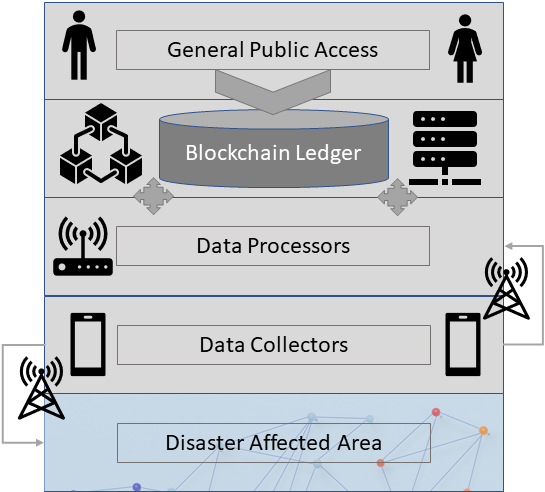
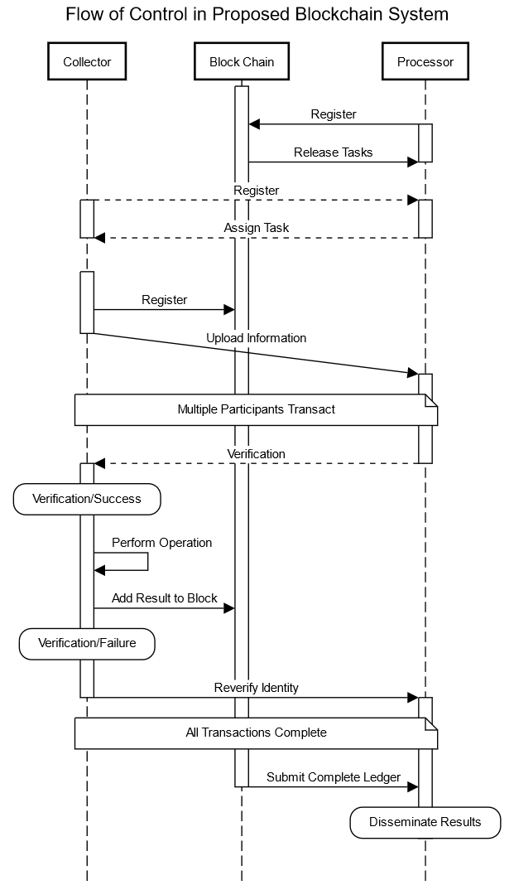

# DEIMOSBC design notes

This document maps every element of our BRAINS 2021 work to the code, explains
the protocol in enough detail to reason about it, and lists the places where
our 2021 description left a decision open and this implementation had to choose.

> Sarbajna, R., Eick, C. F., & Laszka, A. (2021). *DEIMOSBC: A Blockchain-based
> System for Crowdsensing after Natural Disasters.* 3rd Conference on Blockchain
> Research & Applications for Innovative Networks and Services (BRAINS).
> [IEEE Xplore 9569794](https://ieeexplore.ieee.org/document/9569794)



## 1. Design → code map

| Design element (section) | Where | Notes |
|---|---|---|
| III-A.1 Disruption to communication networks | `network.py` | No cellular. Device-to-device radio only, range-limited, lossy. |
| III-A.3 Availability of communication devices (Bluetooth / WiFi) | `network.RadioNetwork` | `collector_range_m` (default 120 m) models WiFi Direct. |
| III-B.1 Robustness, graceful degradation | `contracts/maps.py`, `sim/scenario.py` | Bad data is rejected per trace; a crashed or Byzantine minority of processors does not stop the chain. |
| III-B.2 Collaborative problem solving | `contracts/tasks.py` | Area is partitioned into task cells claimed by volunteers. |
| III-B.3 Decentralisation, no new central authority | `replica.py`, `ledger/block.py` | Authority set fixed in genesis (pre-disaster identities); every decision needs a majority. |
| IV-A System architecture: blockchain holds the current partial graph | `contracts/state.py` (`WorldState.map`) | The map *is* contract state. |
| IV-A "each vertex: (i) neighbours, (ii) location, (iii) sensor data" | `mapping/graph.py` (`Vertex`, `MapGraph.snapshot`) | |
| IV-A "multiple local maps … collated into a global map" | `mapping/graph.py` (`Edge.cell`, `local_map`) | A local map = the edges whose midpoint lies in a task cell. |
| IV-A.1 Data Collector | `nodes/collector.py` | Broadcast to all processors in range, hold queue until integration is confirmed, alerts, re-authentication. |
| IV-A.2.1 Package verification | `packets.verify_package` | Run by processors off-chain *and* by the contract on-chain. |
| IV-A.2.2 Author identification + receipt certificate | `packets.verify_author`, `Processor._on_upload` (`RECEIVED` message) | Registration lookup + Ed25519 signature. |
| IV-A.2.3 Trace processing | `Processor._on_upload` → `SUBMIT_TRACE` tx → `contracts/maps.submit_trace` | Errors are relayed back to the collector (`RESULT` / `NOTICE`). |
| IV-A.2.4 Result provisioning, requester need not be verified | `Processor.map_response`, `nodes/requester.py` | Requesters are anonymous, but can verify the map against genesis. |
| IV-A "Once all the processors are satisfied … make the map available" | `contracts/governance.vote_release` | Majority vote releases map version *n*. |
| IV-A "system is halted when processors detect enough errors" | `governance.propose_freeze` / `vote_freeze` | See *Retirement* below. |
| IV-B.1 Data Summarization System | `mapping/merger.py` (`OverlapChainMerger`) | Overlap → snap, chain, conflict → discard both. |
| IV-B.2 Trace Management System | `tms.py` | Displacement-based sampling, trajectory segmentation. |
| IV-C Register | `contracts/registry.py`, `replica.make_genesis` | Keys per participant; registration recorded on-chain. |
| IV-C Task assignment ("starting point, direction, time, status") | `contracts/state.Task`, `contracts/tasks.py` | |
| IV-C Upload sensory data ("rewards … loses their deposit") | `contracts/maps.py` | Per-submission stake; forfeited on unqualified data. |
| IV-C Smart contract creation ("ensure a task is still available") | `contracts/tasks.claim_task` | Availability = not mapped and not claimed. |
| IV-C Load tasks (global vs. local map consistency) | `Replica` (every processor replays every block) | Consistency is enforced by `app_hash` in each block header. |
| IV-C Broadcast | `Processor.tick` (map push), `Collector` (`MAP` cache), `Requester.ask` | Any worker node can serve the latest released map. |
| IV-C Retirement (freeze, final block, amplification, majority vote) | `governance.py`, `Replica.check_proposal` (`chain_frozen`), `Collector._on_freeze` | |
| II Example scenario: hurricane on the Gulf Coast | `sim/scenario.py`, `sim/roadnet.py` | Flood zones + debris over a street network near Houston. |
| Fig. "Flow of Control" (sequence diagram) | see §3 | |
| Fig. "Framework Requester" | `nodes/requester.py` | Ask message → global map returned. |

## 2. Ledger and consensus

* **Identities.** Ed25519 keys (`crypto.py`). A node's on-chain identity is its
  hex public key.
* **Genesis** (`replica.make_genesis`) fixes the protocol parameters, the
  authority set (Data Processors) and the pre-verified volunteers. Our design
  assumes no trustworthy authority survives the disaster, so the only trusted
  set is the one that "existed since before the disaster".
* **Transactions** are always submitted by a processor. Anything a collector
  authorises (registration, task claim, trace) carries the collector's own
  signature inside the payload, so a processor cannot forge collector data:
  `test_author_identification_rejects_forgery_without_side_effects`.
* **Blocks** use *deferred execution*: the header of block *h* commits to the
  contract state (`app_hash`) and the latest released map (`release_root`)
  after block *h−1*. A proposer never executes speculatively. Validators
  compare the header with their own replica before attesting.
* **Finality.** A block is committed once a strict majority of the authority
  set has signed its hash. An honest processor attests at most one block per
  height, so two conflicting blocks cannot both reach a majority as long as a
  majority is honest. Proposers rotate round-robin. If a proposer is down or
  its block is rejected, the next one in the schedule proposes (a simplified
  view change).
* **State root.** `WorldState.root = H(prev_root, height, merkle(receipts))`.
  Each receipt includes the events the transaction caused, so replicas that
  diverge in any outcome diverge in the root. The full canonical map hash
  (`map_root`) is computed only when a version is released.
* **Audit.** `deimosbc verify chain.jsonl` replays an exported chain from
  genesis and re-checks every link, signature, quorum and state transition.

Why not proof of work? Our processors are pre-verified and a
post-disaster site has neither the energy nor the hardware for mining. A
permissioned majority-attestation chain matches our "majority vote"
language for retirement, and our own future-work note on energy efficiency.

## 3. Message flow (our sequence diagram)



| Diagram arrow | Implementation |
|---|---|
| Processor → Blockchain: *Register* | processor key in genesis `authorities` |
| Blockchain → Processor: *Release Tasks* | `CREATE_TASKS` transaction (cell grid) |
| Collector ⇢ Processor: *Register* / Processor ⇢ Collector: *Assign Task* | beacon lists open tasks → collector signs a `CLAIM` → `CLAIM_TASK` tx → `task_assigned` notice |
| Collector → Blockchain: *Register* | genesis volunteer, or `REGISTER` message → `REGISTER_COLLECTOR` tx |
| Collector → Processor: *Upload Information* | `UPLOAD` broadcast to every processor in range (or `RELAY` via other volunteers) |
| *Multiple participants transact* | processors gossip txs over the mesh; majority-attested blocks |
| Processor ⇢ Collector: *Verification* | `RECEIVED` certificate, then `RESULT` (accepted / rejected / disputed) |
| *Verification / Success* → *Add result to block* | `trace_accepted` receipt; trace chained into the on-chain map |
| *Verification / Failure* → *Reverify identity* | `collector_suspended` → `REAUTH` → `REAUTH_COLLECTOR` tx |
| Blockchain → Processor: *Submit complete ledger* → *Disseminate results* | `VOTE_RELEASE` majority → `map_released`; map pushed to collectors and served to requesters |

## 4. Data path of one trace

```
GPS fix (1 Hz) ─► DisplacementSampler (≥10 m moved, drop >12 m/s spikes)
               ─► TrajectorySegmenter (split on >60° turn / >60 m gap / 120 pts, smooth)
               ─► client checks: overlaps its task cell?
               ─► signed packet {collector, task, seq, points[E7], sensors, hazards}
               ─► queue (one in flight; others wait for confirmation)
               ─► UPLOAD to every processor in range  (or RELAY through volunteers)
Processor      ─► verify_package ─► registered? signature? ─► RECEIVED certificate
               ─► SUBMIT_TRACE tx, gossiped on the mesh
Contract       ─► package + author checks (no state change on failure)
               ─► stake locked ─► quality rules ─► (fail: stake forfeited, error)
               ─► Data Summarization: conflicts? ─► (discard both, errors)
               ─► integrate: snap / split / chain ─► reward, task progress
Processor      ─► RESULT to collector (via outbox when next in range)
```

## 5. Data Summarization System (`mapping/merger.py`)

*Overlap.* A point within `merge_radius_m` (15 m) of an existing vertex snaps
to it. Otherwise, if it is within 15 m of an edge, that edge is split at the
projection. Vertices the same trace created in the last 3 × radius metres
are excluded, so consecutive samples do not collapse onto each other.

*Chaining.* Consecutive snapped vertices are joined. If the map already holds
a short path between them, the trace adds support to that path instead of
creating a shortcut. Every edge records which traces (and so which
collectors) support it.

*Conflict.* Our 2021 description says only "in case of conflict, both traces are
discarded". Two concrete conflicts are implemented:

1. **Geometric.** The trace runs inside the corridor of existing edges for at
   least `conflict_min_run_m` (40 m) while disagreeing with all of them in
   heading by more than 35°. A street that merely *crosses* an existing one
   is too short to qualify (`test_crossing_street_is_not_a_conflict`).
2. **Hazard.** Collectors can attach hazard reports (location and blocked
   heading) to a trace. A conflict occurs when a trace traverses a reported
   hazard in its blocked direction, or reports a hazard on a street that
   another trace traversed.

On a conflict the incoming trace is not added. Every conflicting
already-accepted trace is withdrawn from the map: vertices are anchored, so
withdrawal is reversible. Every involved collector receives a notice and an
error.

## 6. Incentives, errors, re-authentication

* Every collector starts with `initial_collector_balance` (100).
* Each upload locks `submission_stake` (10). Qualified data returns it plus
  `reward_per_trace + reward_per_new_metre × new length`. Unqualified data
  forfeits it ("the worker loses their deposit").
* Each rejection or conflict is an error. After `max_errors_before_reauth`
  (3) errors the collector is suspended and must be re-authenticated by a
  processor. After `max_reauths` (2) re-authentications, the next suspension
  disables it permanently. This is our "Trace Management system …
  disables the data collector".

## 7. Governance

* **Release.** A processor votes to release version *n+1* when the map has
  changed since the last release and either (a) nothing new arrived for
  `release_quiet_blocks`, matching our "satisfied that no more updates
  are required", (b) `release_interval_blocks` have passed, so requesters get
  periodic snapshots, or (c) every task is mapped. A strict majority
  releases. The released snapshot and its hash are stored, and the next
  header's `release_root` commits to it.
* **Retirement.** Every processor watches the share of errors among the last
  `integrity_window` submissions. Past `freeze_error_rate` it proposes a
  freeze. Each processor votes after running its own integrity check. A
  majority freezes the chain at the current height (the *final block*), and
  validators reject every later block. Processors announce the freeze in
  their beacons, and every collector that hears it stops and re-broadcasts it
  ("amplified by every node who received it").

## 8. Interpretation decisions

Where our 2021 description is silent or ambiguous, this implementation chooses:

| Topic | 2021 design | Choice here |
|---|---|---|
| Consensus | "majority vote", "miners validate" | Permissioned majority attestation, round-robin proposer, deferred execution |
| Processor registration | "processors will need to register" | In genesis. Adding processors later would need an authority-set change protocol (future work) |
| What a "conflict" is | not defined | Geometric misalignment over ≥40 m, or hazard vs. traversal (§5) |
| "Discard both" for an already-committed trace | not addressed | The trace is withdrawn from the map state. The chain itself stays append-only |
| Deposit | "loses their deposit" | Per-submission stake + initial balance |
| Map "available for general public use" | when processors are satisfied | Majority release vote with quiet / periodic / complete triggers |
| Requester trust | "need not be verified" | Requesters are anonymous, but the response carries a quorum-signed header so they *can* verify |
| Error threshold for retirement | "pre-arranged threshold" | Error share over a sliding window of submissions |
| Hurricane category | abstract says 5, Sec. II says 4 | Damage is parameterised (flood zones and debris) rather than tied to a category |
| Trajectory segmentation | cites Blanke et al. 2014 | Split on abrupt heading change, GPS gap or maximum length, 3-point smoothing |
| Sensor data | "any additional sensor data" | Arbitrary integer milli-unit fields per point, averaged per vertex |

## 9. Extensions beyond the 2021 design (opt-in)

Both are off by default, so the default run *is* the 2021 design.

* `conflict_policy = "evidence"`. Hazard conflicts are settled by counting
  distinct collectors on each side, and a tie keeps the hazard. Under our
  original rule a single honest hazard report and a single fabricated
  traversal cancel out, and the hazard is lost. A fabricator can then
  re-inject the street.
* `min_release_support = k`. Released maps include only edges traversed by
  at least *k* distinct collectors.

`docs/RESEARCH_NOTES.md` has the measured effect of each.
